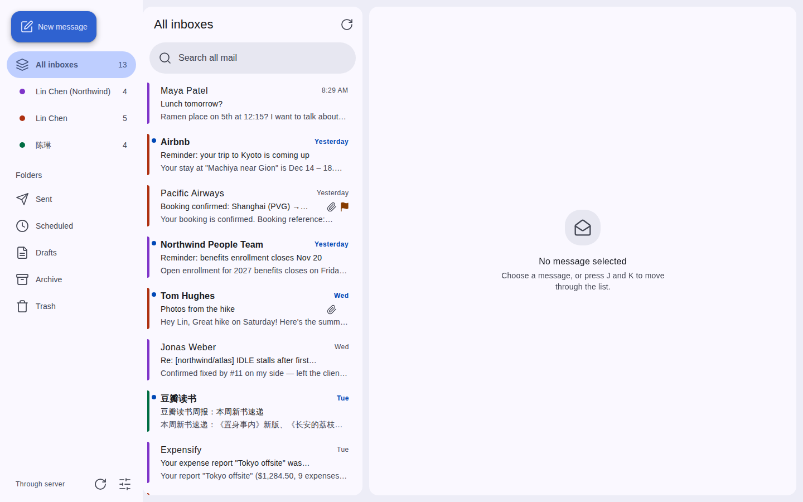
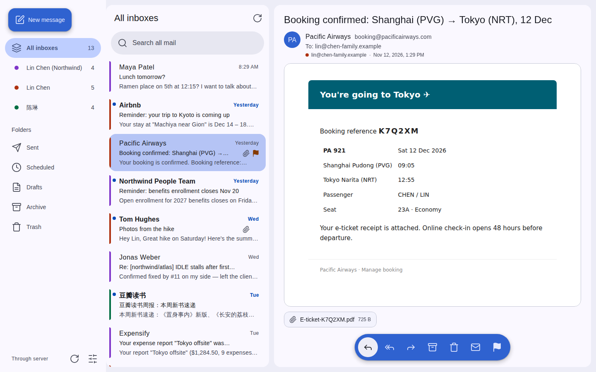
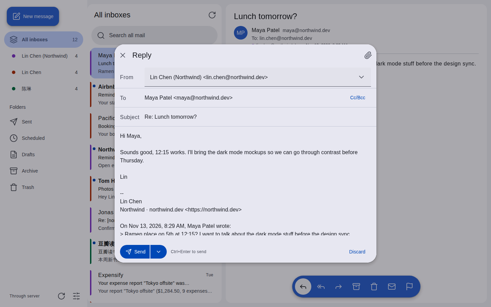
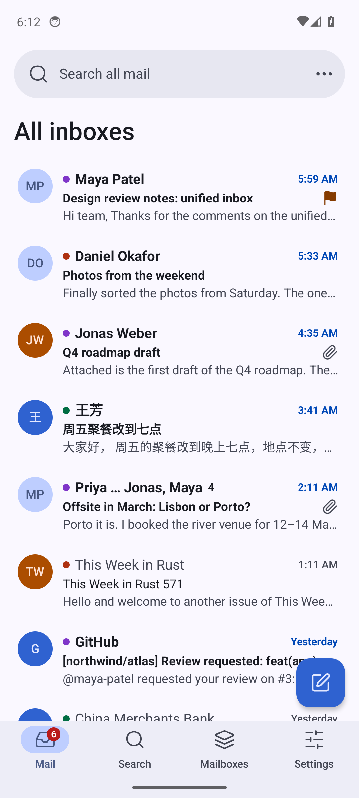
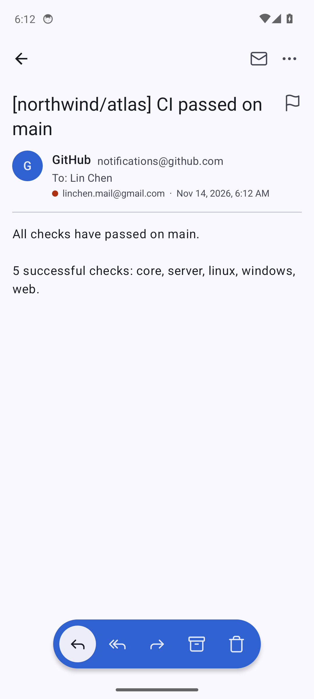

English | [简体中文](README.zh-CN.md)

# nsh-mail

A unified inbox for all your mail accounts, built with [Native Shell](https://nsh.dev). Web, Android, Linux and Windows. Local mode keeps credentials and mail on your device; cloud mode syncs on a server and pushes new mail.

<picture><source media="(prefers-color-scheme: dark)" srcset="https://raw.githubusercontent.com/markbang/nsh-mail/screenshots/main/web-inbox-dark.png"></picture>

| Reader | Compose |
|---|---|
| <picture><source media="(prefers-color-scheme: dark)" srcset="https://raw.githubusercontent.com/markbang/nsh-mail/screenshots/main/web-reader-dark.png"></picture> | <picture><source media="(prefers-color-scheme: dark)" srcset="https://raw.githubusercontent.com/markbang/nsh-mail/screenshots/main/web-compose-dark.png"></picture> |

<picture><source media="(prefers-color-scheme: dark)" srcset="https://raw.githubusercontent.com/markbang/nsh-mail/screenshots/main/android-inbox-dark.png"></picture> <picture><source media="(prefers-color-scheme: dark)" srcset="https://raw.githubusercontent.com/markbang/nsh-mail/screenshots/main/android-reader-dark.png"></picture>

Screenshots are taken by CI from main ([tools/screenshots](tools/screenshots)).

## Install

Download from [Releases](https://github.com/markbang/nsh-mail/releases/latest):

- **Android 8+**: `nsh-mail-<version>-arm64-v8a.apk` for most phones; `armeabi-v7a` for old 32-bit phones, `x86_64` for emulators and Chromebooks, `universal` (all three, larger) if unsure; `nsh-mail-<version>.aab` for Google Play or enterprise distribution. Had a 0.1.x test build installed? Uninstall it once first: releases are signed with a new key (certificate SHA-256 `F3:92:9A:E4:…:6B:4B:42`).
- **Linux x86_64**: `nsh-mail-<version>-linux-x86_64.tar.gz`. Needs GTK 4.14+, and WebKitGTK 6.0 for HTML mail; packages, launcher entry and tray: [docs/linux.md](docs/linux.md).
- **Windows x64**: `nsh-mail-<version>-windows-x64-setup.exe` or the `.zip`. Unsigned, so SmartScreen warns on first run.
- **Web and cloud mode**: the server image `ghcr.io/markbang/nsh-mail` serves the web client ([deploy](crates/server/README.md)).

`SHA256SUMS.txt` in each release lists the checksums.

Design: [docs/design.md](docs/design.md)
