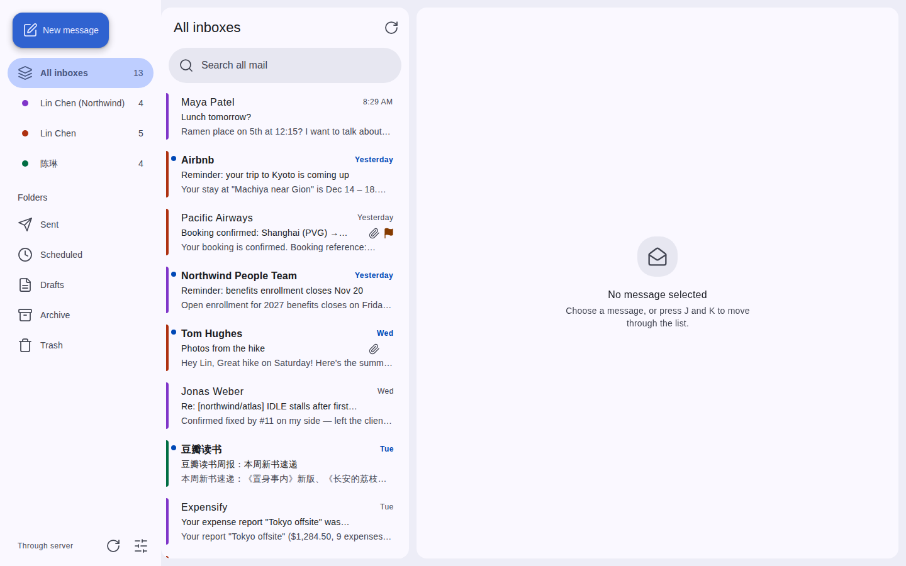
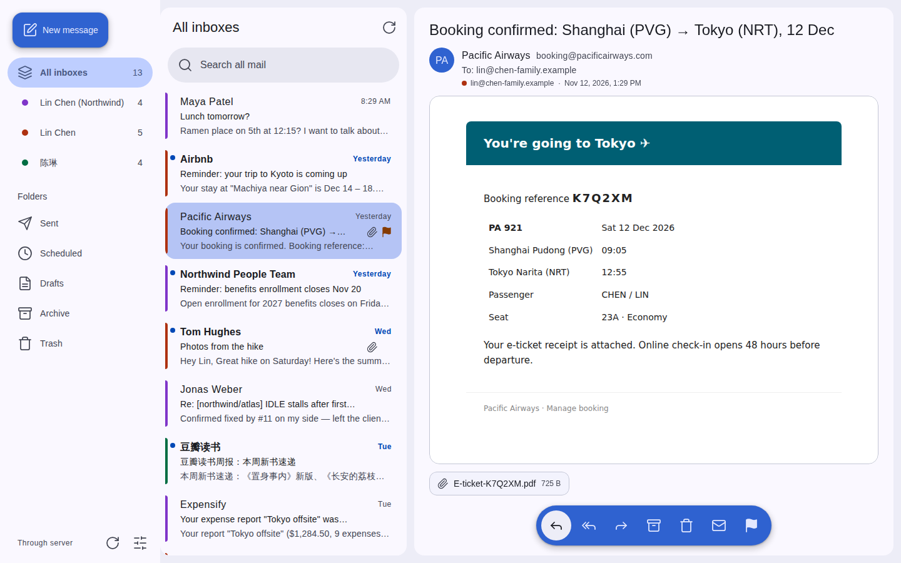
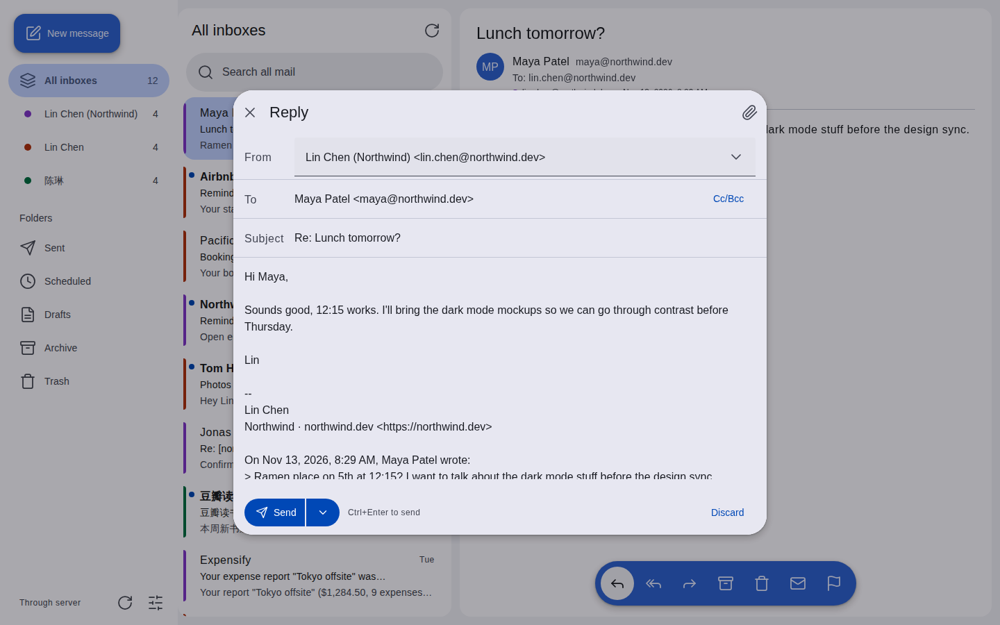
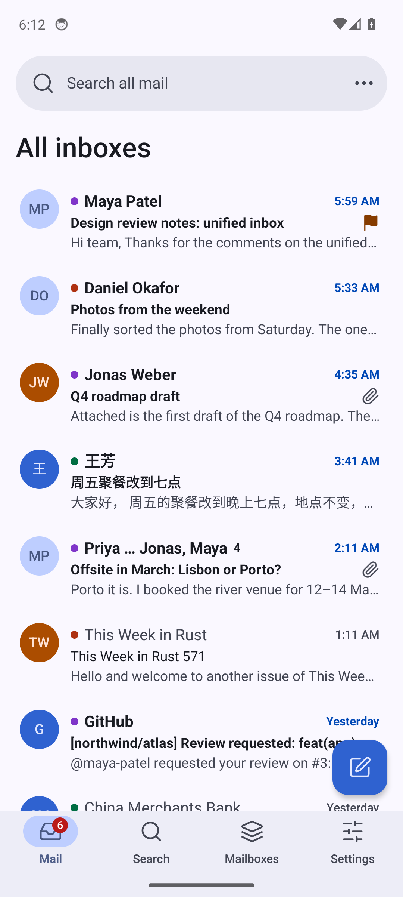
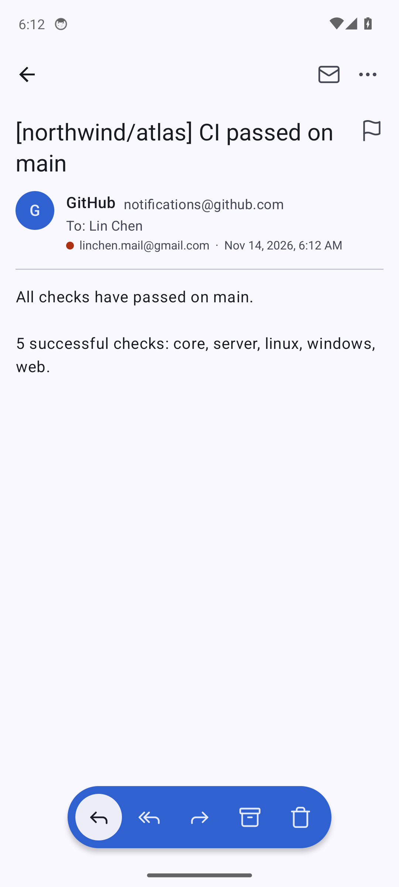

[English](README.md) | 简体中文

# nsh-mail

把所有邮箱放进一个收件箱的客户端，基于 [Native Shell](https://nsh.dev)，支持 Web、Android、Linux、Windows。本地模式凭据和邮件只在本机；云端模式由服务端同步并推送新邮件。

<picture><source media="(prefers-color-scheme: dark)" srcset="https://raw.githubusercontent.com/markbang/nsh-mail/screenshots/main/web-inbox-dark.png"></picture>

| 阅读 | 写信 |
|---|---|
| <picture><source media="(prefers-color-scheme: dark)" srcset="https://raw.githubusercontent.com/markbang/nsh-mail/screenshots/main/web-reader-dark.png"></picture> | <picture><source media="(prefers-color-scheme: dark)" srcset="https://raw.githubusercontent.com/markbang/nsh-mail/screenshots/main/web-compose-dark.png"></picture> |

<picture><source media="(prefers-color-scheme: dark)" srcset="https://raw.githubusercontent.com/markbang/nsh-mail/screenshots/main/android-inbox-dark.png"></picture> <picture><source media="(prefers-color-scheme: dark)" srcset="https://raw.githubusercontent.com/markbang/nsh-mail/screenshots/main/android-reader-dark.png"></picture>

截图由 CI 从 main 自动生成（[tools/screenshots](tools/screenshots)）。

设计：[docs/design.zh-CN.md](docs/design.zh-CN.md)
